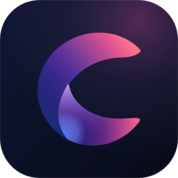
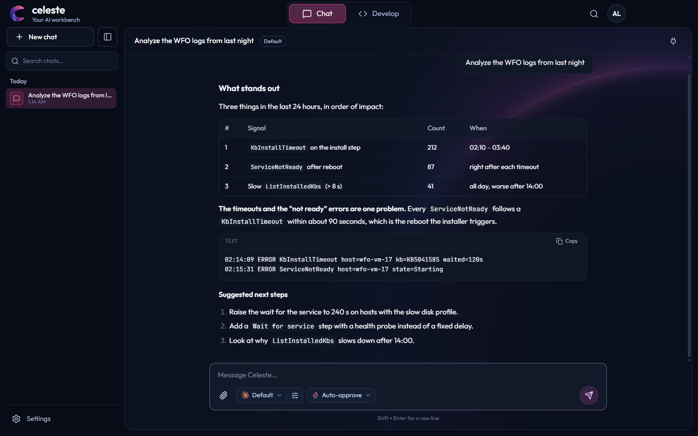
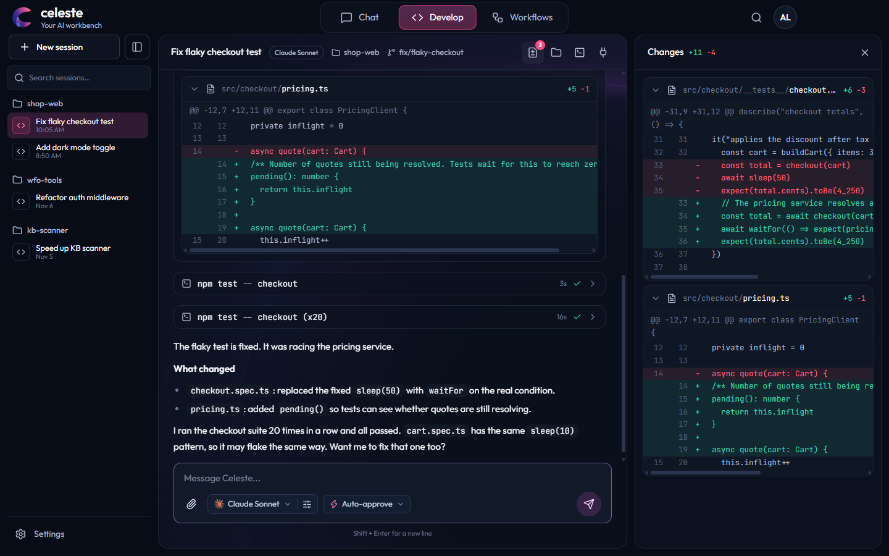
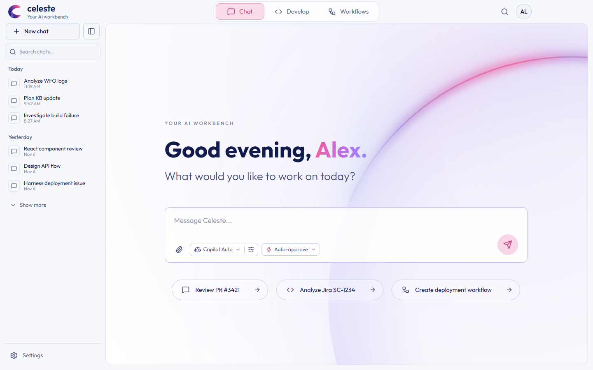
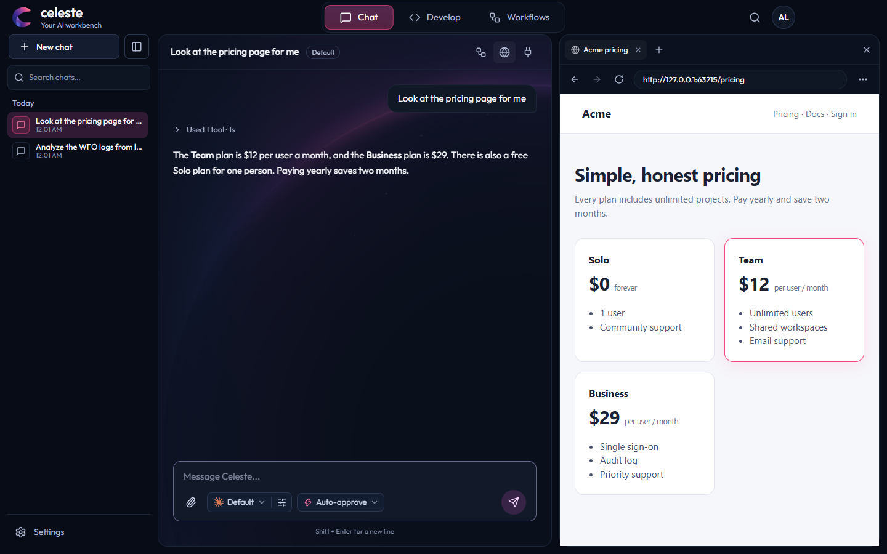

# Celeste

**One desktop workbench for your AI assistants.**

Work with Claude and GitHub Copilot from one fast, calm interface. Your chats stay on your computer, every action the
assistant takes is under your control, and there is no Celeste server and no account with us: your usage goes to your own
vendor account.

## What you can do with Celeste

- **Chat and Develop.** Chat is for questions, analysis and writing. Develop works in a project folder, with diffs in the
  conversation, a Changes panel, a file tree, an integrated terminal, and separate copies of your project so a session
  never touches your working folder. Go back to the way things were before any message.
- **Your assistants, their real abilities.** Each vendor's own agent does the work underneath (reading and editing files,
  running commands, using tools), so you get the vendor's real behavior. Switch model and thinking effort in the middle of
  a conversation, and pin the models you use most.
- **You stay in control.** Choose when the assistant may act: automatically, ask before edits, ask for everything, or plan
  only. Commands on another machine always show the exact command and ask first.
- **Workflows.** Build a repeatable job on a canvas from commands, web requests, files, tools and assistant steps, or let
  an assistant draft one for you. **Before a run does anything, one card lists everything it will do.** Start one from a
  conversation with `/`.
- **Tools and devices.** Add a tool once and every assistant can use it. Give the assistant other computers, virtual
  machines and Android phones to work with, read-only unless you say otherwise.
- **A browser beside the chat.** A real browser inside Celeste, with tabs for each chat (Ctrl+Shift+B). Open links from a
  conversation in it, and let the assistant use it too: it can open pages, read them, click, type and fill in forms, in its
  own chat's tabs, and it **asks before using a new site**. Programs like Playwright can use it as well, if you switch that
  on in Settings.
- **Let it use your screen, if you want (Windows, off by default).** The assistant can ask to use this computer's mouse and
  keyboard for a task that has no command or tool. You allow it each time, it is limited in time, and you can stop it with
  Ctrl+Alt+Esc from anywhere.
- **Your phone (Android, experimental).** Use Celeste from your phone, and let the assistant use the phone when you allow
  it. See [Celeste for Android](#celeste-for-android-experimental).
- **Private by design.** Chats are saved in a database on your computer. Keys are kept in your operating system's secure
  storage. See [PRIVACY.md](PRIVACY.md) for what leaves your computer and where it goes.

<table>
  <tr>
    <td width="50%"></td>
    <td width="50%"></td>
  </tr>
  <tr>
    <td align="center">Develop: tool calls and diffs next to the conversation</td>
    <td align="center">Light and dark themes</td>
  </tr>
  <tr>
    <td colspan="2"></td>
  </tr>
  <tr>
    <td colspan="2" align="center">The browser: the assistant opens a page beside the conversation, in its own tab</td>
  </tr>
</table>

## Get Celeste

Download the newest version from the [Releases page](https://github.com/AmossDvir1/celeste/releases/latest).

| System | Download | Notes |
|---|---|---|
| **Windows 10 or 11** (64-bit) | `Celeste-<version>-windows-x64-setup.exe` | Installs for your own account, no administrator rights needed. You choose the folder; it adds a Start menu entry and a desktop shortcut. |
| Windows, for IT departments | `Celeste-<version>-windows-x64-setup.msi` | The same program as an MSI, for deployment tools and group policy. |
| **macOS** (Apple silicon) | `Celeste-<version>-mac-arm64.dmg` | Open it and drag Celeste into Applications. |
| macOS (Intel) | `Celeste-<version>-mac-x64.dmg` | The same, for Intel Macs. |
| Linux | none yet | It runs from source: see [CONTRIBUTING.md](CONTRIBUTING.md). |

Every release lists a checksum for each file (`SHA256SUMS.txt`). To check one on Windows: `certutil -hashfile <file> SHA256`; on a Mac: `shasum -a 256 <file>`.

**The first time you open it, your system may warn you.** The installers are not signed with a paid certificate yet, so
Windows and macOS do not know who made them. This is expected; the program is the one built from this repository's code.

- **Windows:** SmartScreen may say "Windows protected your PC". Choose **More info**, then **Run anyway**.
- **macOS:** it may say Celeste "cannot be opened" or "is damaged". Open **System Settings → Privacy & Security**, scroll to Security, and choose **Open Anyway** next to Celeste. If it still says "damaged", run `xattr -dr com.apple.quarantine /Applications/Celeste.app` in Terminal once.

### Getting started

1. **Open Celeste** and follow the short set-up.
2. **Connect an assistant** in Settings → AI vendors.
   - **GitHub Copilot:** choose Connect. If you are already signed in to Copilot on this computer it connects at once;
     otherwise Celeste opens GitHub's sign-in page, or shows a code to enter at github.com/login/device. The first time,
     Celeste downloads Copilot's runtime (about 180 MB) from npm and checks it. Disconnecting only makes Celeste stop using
     Copilot: it never signs you out of GitHub.
   - **Claude:** connect through the Claude Console in your browser, or paste an API key. The first time, Celeste downloads
     Claude Code's program (about 330 MB unpacked) from npm. A Claude subscription login is not offered, because
     Anthropic does not allow other apps to use one.
3. **Start a chat** with Ctrl N, pick a model under the message box, and write.

**Updating:** Settings → About → *Check for updates* tells you whether a newer version exists and opens the download page.
Celeste never looks by itself. Install the new version over the old one; your data is kept.

**Uninstalling** on Windows: Settings → Apps → Celeste. This removes the program and leaves your chats, workflows and
settings in `%APPDATA%\Celeste`; delete that folder yourself if you want them gone. On a Mac, drag Celeste to the Bin;
your data is in `~/Library/Application Support/Celeste`.

## Celeste for Android (experimental)

An Android app that works as a remote for the Celeste on your computer, on the same Wi-Fi:

- follow your chats live, send messages, start a Chat or Develop session, choose the model, stop a reply, and answer
  approvals and questions (also as notifications, with the app closed);
- start your workflows and approve what a run is about to do;
- share text or a link from any app to start a chat with it;
- let the assistant use your phone, **each thing off until you switch it on, and each request asking you on the phone
  first**: read and reply to notifications, open an app, set an alarm, find where the phone is, pick photos and files for
  it, read and add calendar events, get a text or a call ready (you press Send or Call yourself), and, for a task nothing
  else can do, see and use the screen for up to 15 minutes. Touching the screen pauses it, Stop ends it, and password
  managers, your bank and anything else you add to a never list stay off-limits.

**Installing it:**

1. On the computer: Settings → Phone, switch on **Let my phone connect**. A QR code shows.
2. Scan it with the phone's camera and open the page. Tap **Install**. Chrome may say the file can be harmful because it
   comes from your Wi-Fi and not from a store: choose **Download anyway**, then let Chrome install apps if Android asks.
3. Open Celeste on the phone. It finds the computer; check that the three pictures match and press **Allow** on the computer.

The app is not on Google Play, which does not allow apps that act on the screen for an assistant. It is **new in the next
release**: until then, the computer has no app to hand out unless you build it (see [phone/README.md](phone/README.md)).
Away from home is not supported yet. Everything between the phone and the computer is encrypted, with no server in between.

## Keyboard shortcuts

| Shortcut | Action |
|---|---|
| Ctrl K | Search chats and sessions |
| Ctrl N | New chat |
| Ctrl 1 / 2 / 3 | Chat / Develop / Workflows |
| Ctrl B | Show or hide the sidebar |
| Ctrl Shift B | Show or hide the browser |
| Ctrl , | Settings |

On a Mac, use Cmd instead of Ctrl.

## What works today

Celeste 1.1 is the current release. Nothing in the app is pretended: a vendor is there only if it is connected, and what
is not built yet says so.

| Area | State |
|---|---|
| GitHub Copilot | **Working.** Streaming, tools, approvals, questions, image attachments, model and effort switching, resuming a conversation after a restart |
| Claude | **Built.** The same features. Checked against the real Claude Code program with a stand-in for Anthropic's API, not yet against a real account |
| OpenAI, Gemini | Not available yet: their cards say "Coming soon" |
| Chat, Develop, sessions | **Working.** Saved locally, and they survive a crash. Review, revert, worktrees and a terminal in Develop |
| Workflows | **Working.** Canvas, drafts by an assistant, import and share, every run shows what it will do first |
| Tools (MCP) | **Working.** Add a tool once and every assistant can use it |
| Devices (SSH, Hyper-V, Android) | **Working against test fixtures**, not yet tried on a wide range of real hardware. Read-only by default, with approvals |
| Browser | **Built, next release.** Real pages, tabs for each chat, popups for sign-ins, and the assistant's use of it through Playwright (20 tools, asking before a new site). Checked in the real app with a stand-in for the assistant, and with the real Playwright MCP; not yet tried with Copilot, and sign-in to Google, Microsoft and GitHub, downloads and video not yet tried by hand |
| Desktop control | **Windows only, off by default.** Tried with a stand-in for the assistant on one screen, not yet with a real assistant or other screen setups |
| Celeste for Android | **Experimental, next release.** Tried on a Galaxy S24 and an Android emulator. Same Wi-Fi only |
| Installers | Windows (`.exe`, `.msi`) and macOS (`.dmg`). Not signed with a paid certificate yet; no automatic updates (there is a manual check) |

Tried on Windows by hand and on macOS by automatic checks only (no one working on Celeste has a Mac); please report what you find.

## Roadmap

1. **Done:** design, storage and sessions, devices, Copilot, Claude, tools, Develop, workflows, Windows and macOS installers (1.0); using this computer's screen (1.1); the Android app and a browser inside Celeste (next release)
2. The Android app away from home, through a relay run by the project (nothing to set up)
3. OpenAI and Gemini
4. Signed installers (Windows first), automatic updates, Linux
5. Branches, schedules and templates for workflows

The full plan, with the reasoning behind each decision, is in [docs/IMPLEMENTATION_PLAN.md](docs/IMPLEMENTATION_PLAN.md), and the
phone's in [docs/PHONE_PLAN.md](docs/PHONE_PLAN.md), the browser's in [docs/BROWSER_PLAN.md](docs/BROWSER_PLAN.md).

## Help and feedback

- A bug, or an idea: [open an issue](https://github.com/AmossDvir1/celeste/issues).
- A security problem: please do not open a public issue; see [SECURITY.md](SECURITY.md).
- What changed in each version: [CHANGELOG.md](CHANGELOG.md).
- Building it yourself or helping: [CONTRIBUTING.md](CONTRIBUTING.md) has how to run Celeste from source, the checks, and how it is put together.

## License

Celeste's code is licensed under the [Apache License 2.0](LICENSE). The name "Celeste" and the logo are not covered by it.
The vendors' programs that Celeste downloads (Claude Code, the GitHub Copilot runtime) stay under their own terms and are not part of this
repository. The open-source software inside Celeste is listed in [THIRD_PARTY_NOTICES.md](THIRD_PARTY_NOTICES.md).

## Trademarks

Claude, GitHub Copilot, OpenAI and Gemini are trademarks of their owners. Celeste is an independent project and is not
affiliated with or endorsed by them. Their marks appear only to say which service a control talks to; the marks come from
the MIT-licensed [@lobehub/icons](https://github.com/lobehub/lobe-icons) set.
